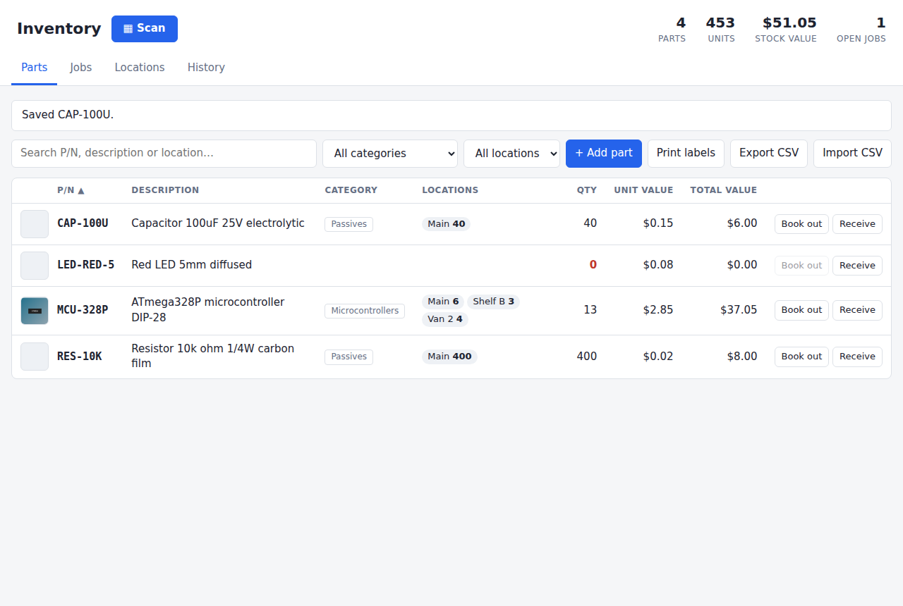
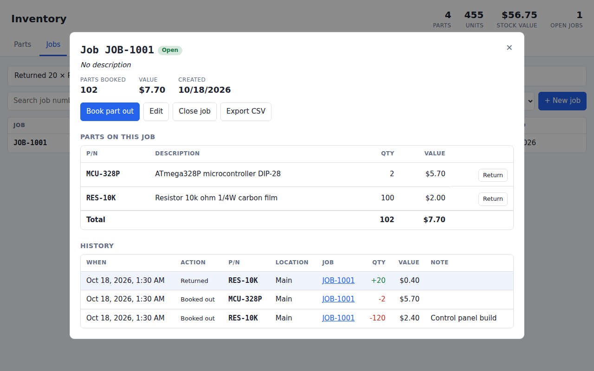
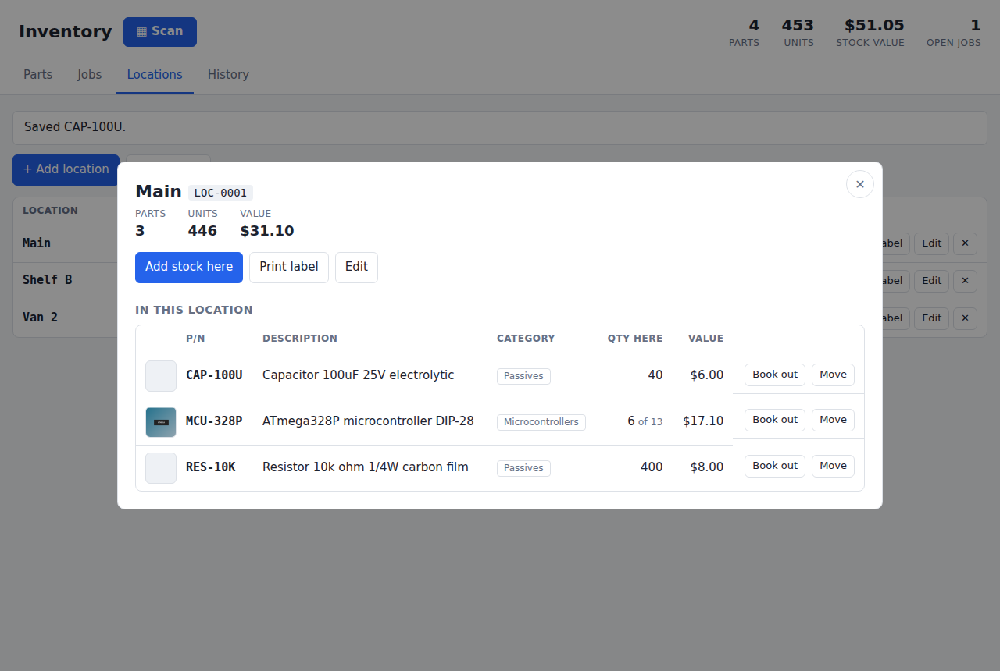
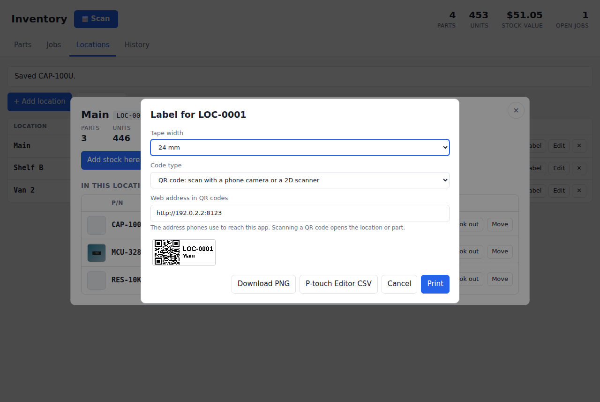

# Inventory

A searchable inventory tracking system for parts. It tracks where each part is kept, which jobs
parts are booked out to, and what everything is worth. Print barcode labels for your containers on a
Brother P-touch (such as the PT-E550W) and scan them to see what's inside.



## Features

**Parts**
- Each part has a **P/N** (part number), **description**, **category**, **unit value** and an optional **picture**.
- Stock is held in one or more **locations** (a shelf, a bin, a van…). The parts list shows how many are at each location, plus the total quantity and value.
- **Search** as you type by P/N, description, category or location name. Every word must match, and matches are highlighted. Press `/` to jump to the search box.
- **Filter** by category or location, and **sort** by any column.
- **Categories:** pick an existing category or type a new one when adding or editing a part.
- **Pictures:** upload a photo of a part. Phone photos are shrunk before uploading.

**Stock movements** (from a part's row, or by clicking a part to open its details)
- **Receive:** add new stock to a location. Type a new location name to create it.
- **Book out to job:** take stock from a location and book it to a job. Type a new job number to create the job.
- **Move:** transfer stock from one location to another.
- **Count:** set the quantity at a location after a stocktake.
- **Return:** send unused parts from a job back into stock (from the job's page).

You can't take out more than a location holds, and every movement is recorded in **History**.

**Jobs**
- Each job shows the parts booked to it (less any returns), how many, and their value.
- A part's value is fixed at the time it's booked out, so later price changes don't alter old jobs.
- You can book parts out from the job's page, close a finished job (closed jobs can't take more parts), reopen it, and export its parts list to CSV.



**Locations (containers):** click a location, or scan its label, to see everything in it, with
quantities and value, and book parts out or add stock right there. Each location has a short
**label code** such as `LOC-0003`. You can change it to match labels you already have.



**CSV export/import:** export gives one row per part per location. Import adds new part numbers, updates existing ones, and sets the stock count at each row's location.

Works on phones as well as desktops.

## Barcode labels and scanning

Use **Print label** on a location or part, or **Print labels** on the Locations or Parts tab for
several at once. Choose your tape width (24, 18, 12 or 9 mm) and the code type:

- **QR code** (recommended): point a phone's camera at it and the location opens in the browser.
  2D handheld scanners read it too.
- **Barcode (Code 128)**: for 1D handheld scanners, which can't read QR codes.



Labels are drawn at the PT-E550W's 180 dpi and printable height for the tape, in pure black and white:


### Printing on the PT-E550W

There are three ways to print, depending on how your printer is set up:

1. **Print**: on a computer with the Brother PT-E550W driver installed (USB or Wi-Fi), click
   **Print** and choose the P-touch as the printer. Each label prints as its own page, sized to the
   tape. In Chrome, open *More settings* and check that *Margins* is *None* and *Scale* is *Default*/100%.
   If labels come out the wrong size, set the driver's paper size to your tape width.
2. **Download PNG**: saves each label as an image tagged 180 dpi. In P-touch Editor, use
   *Insert › Picture*, or print the image from any app that can print to the P-touch.
3. **P-touch Editor CSV**: downloads the label data (`code`, `name`, `link`, contents…) for P-touch
   Editor's database merge. In P-touch Editor, *File › Database › Connect* to the CSV. Add a
   QR Code object linked to the `link` field (or a Barcode object linked to `code`) and text objects
   for `code` and `name`, then print all records. This uses Brother's own barcode rendering.

### Scanning

- **Phone camera**: QR codes hold a link like `http://192.168.1.20:8000/s/LOC-0003`. Scanning one
  opens that location's contents. For phones to reach the app:
  - start it with `python3 run.py --host 0.0.0.0`;
  - keep the phone on the same Wi-Fi network;
  - allow port 8000 through the computer's firewall.

  The label dialog fills in the computer's network address automatically, and warns you if
  the address it would use only works on this computer.
- **USB or Bluetooth barcode scanner** (keyboard mode): just scan anywhere in the app, or use the
  **Scan** button. It also accepts a QR code's link, a part's P/N or a job number.
- **Type it**: the **Scan** button also accepts a code typed by hand.

If the computer's network address changes, phone-camera links on old labels stop working. Give the
computer a fixed address, for example a DHCP reservation in your router. Handheld scanners and the
Scan box still read those labels either way, because the location code is part of the link.

## Running it

Requires Python 3.8+ and nothing else.

```bash
python3 run.py
```

Then open <http://127.0.0.1:8000>.

Options:

```bash
python3 run.py --port 9000 --db /path/to/my-inventory.db
python3 run.py --host 0.0.0.0     # reachable from phones/other computers on your network (needed for QR scanning)
python3 run.py --uploads /path/to/pictures
```

Data is stored in `inventory.db` and pictures in an `uploads/` folder next to it. Back up both.

**Upgrading:** your existing database is converted automatically the first time you start a new
version. Data from the very first version, which had one quantity per part, goes into a location
called **Main**. Existing locations get label codes (`LOC-0001`, …) and parts start with no category.

## CSV import format

The first row must be a header. Column names are case-insensitive; only `part_number` is required.

```csv
part_number,description,category,location,quantity,unit_value
RES-10K,Resistor 10k ohm 1/4W,Resistors,Shelf A,500,0.02
RES-10K,,,Van 2,50,
MCU-328P,ATmega328P microcontroller,Microcontrollers,Shelf B,12,2.85
```

- A part number that already exists updates that part; blank cells leave the existing value alone.
- `quantity` sets the count at that `location`. With no location, `Main` is used.
- Rows with errors are skipped and reported.

## API

| Method | Path | Description |
| --- | --- | --- |
| GET | `/api/items?q=&sort=&order=&location_id=&category=` | Search parts, with stock per location and summary totals (`category=__none__` for uncategorised) |
| POST | `/api/items` | Create a part (`part_number`, `description`, `category`, `unit_value`, optional `quantity` + `location`) |
| GET / PUT / DELETE | `/api/items/{id}` | Get, update or delete a part |
| POST / DELETE | `/api/items/{id}/image` | Upload (raw image body: JPEG, PNG, GIF or WebP, max 10 MB) or remove the picture |
| POST | `/api/items/{id}/receive` | `{location, quantity, note}` |
| POST | `/api/items/{id}/book-out` | `{location, job, quantity, note}` |
| POST | `/api/items/{id}/return` | `{job, location, quantity, note}` |
| POST | `/api/items/{id}/transfer` | `{from_location, to_location, quantity, note}` |
| POST | `/api/items/{id}/count` | `{location, quantity, note}`: sets the quantity at the location |
| GET | `/api/items/{id}/history` | Movements for a part |
| GET / POST | `/api/locations` | List (with totals) or create locations (`name`, `notes`, optional `code`) |
| GET | `/api/locations/{id}` | A location and the parts in it |
| PUT / DELETE | `/api/locations/{id}` | Edit name/code/notes, or delete an empty location |
| GET | `/api/scan?code=` | What a scanned code is: `{type: location\|part\|job, id}`. Accepts label links too |
| GET | `/s/{code}` | Short link used in QR codes; opens the app on that location/part |
| GET | `/api/categories` | Categories in use, with part counts |
| GET | `/api/labels.csv?type=locations\|parts&base=&ids=` | Label data for P-touch Editor |
| GET | `/api/info` | This computer's network address, for QR links |
| GET / POST | `/api/jobs?q=&status=` | List or create jobs |
| GET / PUT / DELETE | `/api/jobs/{id}` | Job with its parts and history; update `number`/`description`/`status`; delete (only if nothing booked) |
| GET | `/api/jobs/{id}/export.csv` | Parts booked to a job as CSV |
| GET | `/api/history?q=` | All stock movements |
| GET | `/api/summary` | Totals for the header |
| GET | `/api/export.csv?q=&location_id=` | Download stock as CSV |
| POST | `/api/import` | Upload CSV text |

## Tests

```bash
python3 -m unittest -v
```

## Third-party code

`static/vendor/qrcode.js` is [QR Code Generator](https://github.com/kazuhikoarase/qrcode-generator)
by Kazuhiko Arase, MIT license. "QR Code" is a registered trademark of DENSO WAVE INCORPORATED.
